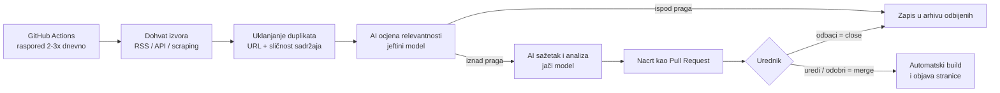

# Specifikacija projekta — Data Governance Signal

> Naziv: **Data Governance Signal** (datagovernancesignal.com)
> Podnaslov: *What matters in data governance, and why.*
> Status: v0.2 — naziv odabran, katalog izvora v0.1 izrađen
> Jezik portala: engleski · Jezik projektne dokumentacije: hrvatski

---

## 1. Dogovorene odluke

| # | Tema | Odluka |
|---|------|--------|
| 1 | Niša | Uži fokus na **Data Governance**, uz zasebnu širu rubriku **Data & AI** |
| 2 | Cilj | **Portal kojem se vjeruje** u području Data Governancea; dugoročno **prihod** |
| 3 | Redoslijed | **Portal je glavni proizvod.** Prijava na newsletter postoji od prvog dana, a slanje počinje kad se skupi publika |
| 4 | Tehnologija | **Kod** (statična stranica + automatizacija na GitHubu) |
| 5 | Uredničko vrijeme | Nije ograničenje: svaka vijest prolazi ručno odobrenje |
| 6 | Proračun | Do ~30 € mjesečno u prvoj fazi |
| 7 | AI | Ništa se ne objavljuje bez odobrenja urednika; uloga AI-ja je javno navedena |
| 8 | Naziv i domena | **Data Governance Signal**, `datagovernancesignal.com` (kratko: DG Signal) |
| 10 | Newsletter | **Za sada bez newslettera** (odluka 28. 10. 2026.): portal ne prikuplja e-mail adrese; umjesto prijave svugdje je kontakt s urednikom. Vraća se postavkom `SITE.newsletter = true` kad se riješi pitanje voditelja obrade (Privacy) |
| 9 | Jezik | **Samo engleski** (odluka 27. 10. 2026.). Drugi jezik tek ako analitika nakon 2–3 mjeseca pokaže veliku jezičnu skupinu čitatelja (npr. >20 %); tada prvo newsletter na tom jeziku. Hrvatsko tržište eventualno kao zaseban projekt, ne prijevod portala |

---

## 2. Vizija

> **Misija (25. 10. 2026.):** jedini izvor koji spaja **regulaciju, AI governance i praktični data management** (MDM, kvaliteta podataka, metapodaci i katalozi) za ljude koji to provode u organizacijama. Svaka vijest odgovara na tri pitanja: što se promijenilo, je li to već obveza, što treba provjeriti.
>
> *Mission (EN):* Regulation, AI governance and practical data management — connected, for the people who make it work.
>
> **Cilj:** biti br. 1 u toj niši po povjerenju i korisnosti. Mjerila su u odjeljku 11.

Međunarodni stručni portal na engleskom koji prati područje Data Governancea, izdvaja ono što je stvarno važno i objašnjava **zašto je važno i na koga utječe**.

Ne natječemo se brojem objava. Natječemo se:
- **pouzdanošću**: svaka vijest ima izvor, a sažetak je provjeren,
- **uštedom vremena**: urednički odabir umjesto poplave vijesti,
- **kontekstom**: poslovni utjecaj, pogođeno područje governancea, povezane vijesti.

## 3. Publika

**Primarna publika (uži fokus):**
- voditelji Data Governancea i Data Management uredi
- Chief Data Officeri (CDO) i Chief Data & Analytics Officeri
- data stewardi i data owneri
- stručnjaci za privatnost, usklađenost i rizike (DPO, compliance, risk)
- konzultanti za podatke i upravljanje podacima

**Sekundarna publika (širi dio):**
- data arhitekti, data inženjeri, analitičari i AI/ML timovi koje zanima governance kontekst

## 4. Struktura sadržaja

### 4.1 Uži fokus — Data Governance (glavne kategorije)

| Kategorija (EN) | Što pokriva |
|-----------------|-------------|
| Governance Strategy & Operating Models | okviri (DAMA-DMBOK, DCAM…), organizacija, uloge, zrelost |
| Data Quality | alati, metodologije, mjerenje kvalitete, incidenti |
| Metadata, Catalogs & Lineage | data katalozi, poslovni rječnici, lineage, data marketplace |
| Privacy & Data Protection | GDPR, prava ispitanika, anonimizacija, privacy engineering |
| Regulation & Compliance | EU AI Act, Data Act, Data Governance Act, DORA, NIS2, sektorski propisi |
| AI Governance | upravljanje AI modelima, odgovorni AI, AI rizici, standardi (ISO/IEC 42001) |
| Master & Reference Data | MDM, referentni podaci, data products |
| Security & Access | upravljanje pristupom, klasifikacija podataka, DSPM |
| Vendors & Market | lansiranja proizvoda, akvizicije, investicije, analitička izvješća |

### 4.2 Šira rubrika — Data & AI
- Data Platforms & Architecture (lakehouse, data mesh, data fabric)
- Analytics & BI
- AI Industry (samo vijesti s utjecajem na podatke i governance)

Šira rubrika ima **viši prag relevantnosti** kako ne bi zagušila glavni fokus.

### 4.3 Vrste sadržaja (oznake)
`Regulation` · `Product launch` · `Acquisition / Funding` · `Research / Report` · `Standard / Framework` · `Case study` · `Incident / Fine` · `Event`

### 4.4 Format vijesti

Svaka objavljena vijest ima:

1. **Naslov**: vlastiti, informativan, bez clickbaita
2. **Sažetak**: 80–150 riječi, vlastitim riječima
3. **Why it matters**: 2–4 rečenice o poslovnom značenju
4. **Governance area affected**: jedna ili više kategorija iz 4.1
5. **Who should care**: uloge na koje vijest utječe (npr. CDO, DPO, steward)
6. **Importance**: 1–5 (urednička ocjena, AI predlaže)
7. **Sources**: svi izvori s poveznicama i originalnim datumom
8. **Related**: povezane ranije vijesti

Točke 3–5 su naša razlika u odnosu na generičke agregatore.

## 5. Načela povjerenja (urednička politika)

Budući da je glavni cilj **portal kojem se vjeruje**, ova pravila vrijede od prvog dana i bit će javno objavljena na stranici *Editorial Policy*:

1. **Izvor uz svaku vijest**: uvijek poveznica na original; primarni izvori imaju prednost pred prepričavanjem.
2. **Ljudsko odobrenje**: AI priprema nacrte, a urednik odobrava, uređuje ili odbacuje svaku objavu.
3. **Transparentnost o AI-ju**: jasno navedeno kako se AI koristi u pripremi sadržaja.
4. **Bez kopiranja**: samo vlastiti sažeci, bez preuzimanja cijelih tekstova i tuđih slika.
5. **Ispravci**: javna politika ispravaka; ispravljeni članci imaju vidljivu napomenu.
6. **Odvojenost komercijalnog sadržaja**: sponzorirani sadržaj uvijek je jasno označen i nikad ne utječe na uredničku ocjenu važnosti ni na redoslijed vijesti.
7. **Neovisnost o dobavljačima**: vijesti o dobavljačima ocjenjuju se po stvarnom utjecaju, a ne po njihovom marketingu.

## 6. Model prihoda (faze)

Prihod dolazi **nakon** što portal ima publiku i ugled. Prerana komercijalizacija ugrožava povjerenje.

| Faza | Uvjet | Izvor prihoda |
|------|-------|---------------|
| 0 | lansiranje | nema; gradi se sadržaj, SEO i lista pretplatnika |
| 1 | stalna publika i aktivan newsletter | sponzorirani slot u newsletteru (jasno označen) |
| 2 | prepoznatljivost u niši | imenik dobavljača / alata (označene plaćene pozicije), oglasi za poslove |
| 3 | ugled i arhiva podataka | premium izvješća, tržišne analize, plaćeni pregledi trendova |

Cilj prve godine je publika i povjerenje, ne prihod.

## 7. Newsletter

- **Obrazac za prijavu na portalu od prvog dana** (početna stranica, dno svakog članka).
- Newsletter se zove **The Monday Signal** i izlazi **ponedjeljkom** (odluka 25. 10. 2026.): urednikova kolumna + najvažnije vijesti prošlog tjedna. Kolumna se uvijek objavljuje i na portalu (`/monday-signal/`); slanje e-mailom ručno iz Buttondowna (tekst je gotov u PR-u) dok ne uvedemo automatsko slanje.
- Alat: neki od servisa s besplatnim početnim paketom (npr. Buttondown, Beehiiv); odluka u fazi 2.

## 8. Tehnička arhitektura (MVP)

| Sloj | Izbor | Napomena |
|------|-------|----------|
| Web | **Astro** (statična stranica) | brzo, jeftino, odlično za SEO |
| Sadržaj | Markdown datoteke u repozitoriju | svaka vijest = jedna datoteka, puna povijest izmjena |
| Pretraživanje | **Pagefind** | statično pretraživanje, bez servera |
| Hosting | Cloudflare Pages ili Netlify | besplatni paket, HTTPS uključen |
| Automatizacija | **GitHub Actions** (cron) | dohvat, AI obrada, otvaranje nacrta |
| Stanje obrade | JSON/SQLite u repozitoriju | već viđene vijesti, log grešaka, potrošnja AI-ja; baza se uvodi tek ako zatreba |
| AI | API velikog jezičnog modela | dva modela: jeftini za ocjenu, jači za sažetke; dobavljač se bira u fazi 4 |
| Uredničko odobrenje | **Pull Request na GitHubu** | pregled, izmjena i odobrenje i s mobitela (GitHub aplikacija) |
| Analitika | Cloudflare Web Analytics ili Plausible | bez kolačića, u skladu s GDPR-om |

**Zašto PR kao urednički alat:** nema dodatnog admin sučelja ni troška, svaka izmjena je zabilježena, a odobrenje je jedan klik. Ako se pokaže nepraktičnim, kasnije se može dodati jednostavno urednično sučelje.

**Dogovoreni urednički tijek (odluka 24. 10. 2026.):**
- jedan Pull Request po vijesti, naslov `Draft: <naslov> — Importance N`
- obavijest u GitHub aplikaciji na mobitelu (urednik ju je instalirao)
- **Merge** = objava · **Close** = odbacivanje · uređivanje datoteke u PR-u = ispravak prije objave
- u opisu PR-a: sažetak, Why it matters, Who should care, kategorije, prijedlog kartice, izvori i AI obrazloženje ocjene
- ako se nakon 1–2 tjedna pokaže nespretnim → vlastita urednička stranica (`/editor`, zaštićena prijavom)

**Kontrola troškova:** dnevni i mjesečni limit potrošnje AI-ja u kodu; obrada staje i javlja grešku kad se limit dosegne.

## 9. Katalog izvora

**v0.2:** 53 izvora — 39 RSS, 7 čitanje stranice, 6 ručno, 1 neaktivan. Prikupljanje i AI obrada rade automatski svaka 3 sata (`pipeline/ingest.py`, izvještaj u `data/reports/latest.md`). Pregled je u [katalog-izvora.md](katalog-izvora.md), a podaci u [`data/sources.yaml`](../data/sources.yaml).

Cilj: **30–50 izvora** u prvoj verziji. Za svaki izvor bilježimo:

| Polje | Primjer |
|-------|---------|
| Naziv | — |
| URL | — |
| Vrsta | regulator / dobavljač / analitičar / udruga / medij / blog / istraživanje |
| Kategorije | iz 4.1 / 4.2 |
| Način dohvata | RSS / API / scraping / ručno |
| Pouzdanost | 1–3 (primarni izvor = 3) |
| Prioritet | visok / srednji / nizak |
| Napomena | npr. uvjeti korištenja, učestalost objava |

Okvirne skupine izvora:
- **Regulatori i institucije:** Europska komisija, EDPB, nacionalna tijela za zaštitu podataka, ENISA, NIST, ISO
- **Stručne udruge:** DAMA International, EDM Council, IAPP
- **Analitičke kuće:** javno dostupni sažeci i priopćenja
- **Dobavljači:** vodeći alati za governance, katalog, kvalitetu i privatnost (blogovi i priopćenja)
- **Stručni mediji i blogovi:** specijalizirani portali i autori iz područja

## 10. Revidirane faze

| Faza | Sadržaj | Rezultat |
|------|---------|----------|
| 1 ✅ | Specifikacija + katalog izvora | ovaj dokument + `data/sources.yaml` |
| 2 ✅ | Kostur portala: početna, kategorije, članak, pretraživanje, Editorial Policy, prijava na newsletter | portal s probnim vijestima (lokalno / testna adresa) |
| 3 ✅ | Dohvat izvora, duplikati, log grešaka | automatski dotok vijesti u arhivu |
| 4 | AI ocjena, sažetak, „why it matters", nacrti kao PR | AI priprema nacrte za odobrenje |
| 5 | Interni pilot 2 tjedna: točnost, duplikati, troškovi, ispadi izvora | pouzdan proces |
| 6 | Naziv, domena, HTTPS, SEO, analitika, početni sadržaj | javno lansiranje |

## 10a. Plan faze 4 (dogovoreno, čeka 3–5 dana podataka iz prikupljanja)

1. ✅ **Dobavljač AI modela** — Anthropic Claude (Haiku 5.5 za trijažu, Opus 5.5 za nacrte); API ključ u GitHub secretu, mjesečni limit 12 $ u kodu. Procjena ~8–10 $/mj.; prvo pokretanje 24. 10.: 5 stavki, 1 nacrt, 0,04 $.
2. ✅ **AI obrada** (`pipeline/draft.py`) — ocjena relevantnosti (jeftini model), nacrt članka u dogovorenom formatu (jači model): sažetak, Why it matters, Who should care, kategorije, važnost, prijedlog kartice; povezivanje iste vijesti iz više izvora.
3. ✅ **Nacrti kao Pull Requestovi** (push obavijest uredniku potvrđena 24. 10.) — jedan PR po vijesti, urednik je zatražen kao recenzent i dodijeljen (obavijest u GitHub aplikaciji).
4. ⏸️ **Newsletteri kao izvori** (odgođeno 24. 10. na odluku urednika; `sources@` i pohrana ostaju aktivni, automatska obrada nije uključena) — adresa `sources@datagovernancesignal.com`; Cloudflare Email Worker sprema izdanja, automatizacija vadi poveznice. Članci se pišu iz izvornog članka, uz navod „via …” za newsletter. Prvi: newsletter Nenada Bakića (Substack) — `sources@` pretplaćen 24. 10. 2026., izdanja nedjeljom ujutro. Poveznice u e-mailu idu preko Substack/Mailgun preusmjeravanja (`email.mg-d0.substack.com/c/…`) — pipeline ih mora razriješiti do izvornog članka i preskočiti odjavu i interne Substack poveznice.
5. ✅ **Substack izvori** (EU AI Act Newsletter, Modern Data 101) — dohvat preko Cloudflare posrednika `/feeds/<id>` (samo ta dva feeda).
6. **AI ilustracije** za vijesti važnosti 4–5 (opcija C), uz odobrenje urednika.
7. ✅ **Stranica Privacy** — `/privacy/`; prije lansiranja dopuniti pravni naziv voditelja obrade i servis za newsletter.

## 10a-2. The Monday Signal (odluka 25. 10. 2026.)

- **Tjedna kolumna urednika** svakog ponedjeljka: komentar prošlog tjedna, predviđanja i provjera ranijih predviđanja. Označena kao *Opinion*.
- **Potpis: pseudonim „The Steward”** (urednik je zaposlen u struci). Na About i uz kolumnu jasno piše da je pseudonim praktičara (MDM od 2011., data governance od 2019., governance i AI governance uloge), bez podataka koji identificiraju osobu; sukob interesa se navodi. Pseudonim je postavka `COLUMN.author` u `src/data/site.ts`.
- **Tracker predviđanja** (`/predictions/`, podaci u `data/predictions.yaml`): naša predviđanja (s postotkom vjerojatnosti i rokom) i predviđanja drugih (regulatori, tvrtke, analitičari — uvijek doslovni citat i poveznica). Na rok urednik označi ishod (*came true / partly / did not happen / void*) s dokazom. Objavljeno se ne mijenja. Prikazuje se postotak pogodaka i Brierova ocjena.
- **Automatizacija:** ponedjeljkom u 05:47 UTC (06:47 po zimskom, 07:47 po ljetnom vremenu) Cloudflare Cron pokreće `.github/workflows/monday.yml` → `pipeline/monday.py` otvara PR „Monday Signal YYYY-MM-DD: …” s nacrtom kolumne (iz vijesti objavljenih u proteklih 7 dana), predloženim predviđanjima (tuđa samo ako se citat doslovno nalazi u izvoru), predviđanjima kojima ističe rok i tekstom newslettera. Urednik prepiše kolumnu svojim glasom, uredi predviđanja, spoji (= objava) i pošalje newsletter. Trošak ≈ 0,3–0,6 $ tjedno, unutar limita 12 $.
- Ishod Cloudflare pokretanja: KV ključ `cron:last-monday` (za prikupljanje `cron:last`).

## 10a-3. Institucije (odluka 25. 10. 2026.)

- Uz teme (kategorije) svaka vijest ima i **institucije koje su djelovale** (odlučile, kaznile, presudile, donijele, objavile), a ne izvor preko kojeg smo vijest našli. Popis: `src/data/institutions.ts` (31 institucija u 5 skupina), proširuje se po potrebi.
- Stranice `/institutions/` i `/institutions/<id>/` prikazuju samo institucije s barem jednom objavljenom vijesti.
- AI kod pisanja nacrta bira institucije s popisa; urednik ih vidi u PR-u („Institutions”) i ispravlja u polju `institutions:`.
- Kasnije: praćenje pojedine institucije u newsletteru (kandidat za premium).

## 10a-4. Glavna vijest na početnoj (odluka 27. 10. 2026.)

- Glavna vijest = najveći zbroj **važnost − 0,5 × starost u danima** (vijesti do 14 dana). Kritična vijest ostaje na vrhu oko 2 dana, važna oko 1 dan, osim ako stigne nešto jednako važno.
- **Ručno prikvačivanje:** u PR-u dodati `featuredUntil: GGGG-MM-DD`; vijest je glavna do tog datuma (uključivo).
- Stranica se ponovno gradi pri svakom spajanju i **svako jutro** (prvo prikupljanje u 06 UTC), pa se vrh i kalendar rokova mijenjaju i u mirnim danima.

## 10a-1. Standard točnosti (odluka 25. 10. 2026.)

- Za sekundarne vijesti automatski se traži i čita **primarni izvor** (web ili PDF) i citira se prvi.
- **Provjera činjenica** (svaka tvrdnja prema izvorima) za vijesti **važnosti 4–5**; za važnost 3 urednik dobiva napomenu da sam provjeri ključne činjenice.
- Mjesečni limit AI troška ostaje **12 $**; kad se dosegne, odabrane vijesti čekaju sljedeći mjesec.

## 10b. Pilot (od 24. 10. 2026., 1–2 tjedna) i priprema lansiranja

**Što pratimo:** broj i kvalitetu nacrta, udio objavljenih/odbačenih, točnost u odnosu na izvore, propuštene važne vijesti, potrošnju AI-ja (`data/reports/drafts.md`), ispade izvora (`data/reports/latest.md`).

**Lansiranje: petak 30. 10. 2026. u 12:00 (Zagreb, CET) = 11:00 UTC** (odluka 28. 10.). Do tada traka na vrhu svake stranice odbrojava (`SITE.launchAt`).

**Automatski u trenutku lansiranja** (Worker cron `55 10 30 10 *` → `.github/workflows/launch.yml` → `pipeline/launch.py`; rezerva: GitHubov raspored; ručno: *Actions → Public launch → Run workflow*, opcija *now*): skripta čeka do 11:59, postavlja `SITE.preview = false` i briše probne članke, commit i push → Cloudflare objavi za ~1 min. Tada nestaju traka i `noindex`, `robots.txt` otvara stranicu tražilicama uz Sitemap. Ishod pokretanja: KV `cron:last-launch`.

**Kontrolna lista za lansiranje (faza 6):**
- [ ] dotjerati pragove i upute trijaže prema iskustvu iz pilota (nakon lansiranja, s podacima iz pilota)
- [x] `SITE.preview = false`, ukloniti probne članke (`sample: true`) — automatski 30. 10. u 12:00
- [x] `robots.txt`: dopustiti indeksiranje + Sitemap — automatski (generira se iz `SITE.preview`)
- [ ] Privacy: identitet voditelja obrade (GDPR čl. 13 traži ime/naziv i kontakt; s pseudonimom otvoreno pitanje — vidi bilješku urednika)
- [x] odabrati i spojiti newsletter servis (obrazac za prijavu) — Buttondown, 25. 10.
- [x] About: kratki opis urednika (pseudonim The Steward)
- [ ] provjera žiga (EUIPO/USPTO)
- [x] ⏸️ newsletter odgođen (odluka 28. 10.) — prijava skrivena, Monday Signal izlazi samo na portalu
- [ ] ⏸️ LinkedIn stranica portala (odvojena od osobnog profila) i prva objava — odgođeno 25. 10. na odluku urednika

## 10c. Ključevi i rokovi obnove

| Ključ | Gdje se koristi | Dozvole | Ističe |
|---|---|---|---|
| `ANTHROPIC_API_KEY` | GitHub secret (AI obrada) | API, mjesečni limit na računu | — |
| `BUTTONDOWN_API_KEY` | GitHub secret (mjesečne brojke) | Subscribers: Read | — |
| `GITHUB_TOKEN` (`dgs-cloudflare-cron`) | Cloudflare Worker secret (okidač svaka 3 sata) | ovaj repozitorij, Actions: Read and write | **25. 10. 2027.** — obnoviti prije isteka |

## 11. Kriteriji uspjeha

**Operativni (od lansiranja):**
- svaka vijest ima izvor i poveznicu
- nula duplikata u objavljenim vijestima
- evidencija neuspjelih obrada i potrošnje AI-ja
- AI troškovi unutar zadanog limita

**Publika i povjerenje (prvih 3–6 mjeseci):**
- broj pretplatnika na newsletter
- udio povratnih posjetitelja
- organski promet za ključne pojmove iz niše
- citiranja i dijeljenja (LinkedIn, poveznice s drugih stranica)

## 12. Otvorena pitanja

- [x] Naziv portala: Data Governance Signal
- [x] Kupljena domena datagovernancesignal.com (Namecheap, 2026-10-24)
- [x] DNS prebačen na Cloudflare (aktivno 2026-10-24)
- [x] E-mail editor@datagovernancesignal.com (Cloudflare Email Routing, prosljeđivanje na Gmail)
- [ ] Provjera žiga (EUIPO/USPTO)
- [ ] Dobavljač AI modela (faza 4)
- [x] Newsletter servis: Buttondown (`buttondown.com/datagovernancesignal`, double opt-in, bez praćenja)
- [x] Statistika posjeta: Cloudflare Web Analytics (bez kolačića)
- [x] Hosting: Cloudflare Pages (statična stranica, Astro)
- [ ] Dopuna kataloga izvorima koje već pratiš (vidi „Što nedostaje” u katalogu)
